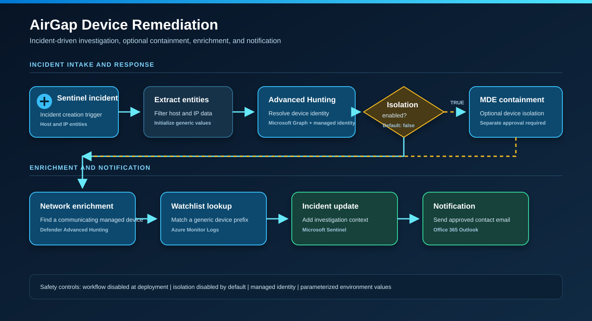

# AirGap Device Remediation

This Microsoft Sentinel playbook investigates an air-gapped device found on a routed network, optionally contains the unmanaged device through Microsoft Defender for Endpoint, enriches the incident, looks up a notification contact from a Sentinel watchlist, comments on the incident, and sends an email.

The workflow is deployed disabled, and device isolation defaults to `false`.

## Deploy

## Workflow

1. Trigger on Microsoft Sentinel incident creation.
2. Extract Host and IP entities from the incident.
3. Resolve the offender device ID with Microsoft Defender Advanced Hunting.
4. Optionally contain the unmanaged device when `enableIsolation` is explicitly set to `true`.
5. Find a managed device that recently communicated with the offender IP.
6. Query the `AirGapContacts` Sentinel watchlist using the offender device-name prefix.
7. Add an incident comment and email the matched contact.

## Architecture

The diagram uses generic entities and parameter names only. It contains no tenant, subscription, device, user, contact, or incident identifiers.

## Connectors and APIs

| Component | Purpose |
| --- | --- |
| Microsoft Sentinel | Incident trigger and incident comment |
| Azure Monitor Logs | Sentinel watchlist lookup |
| Office 365 Outlook | Notification email |
| Microsoft Graph Advanced Hunting | Device identity and network enrichment |
| Microsoft Defender for Endpoint API | Optional unmanaged-device containment |

## Prerequisites

- Microsoft Sentinel with incidents that include Host and IP entities.
- A watchlist alias matching `watchlistAlias`, default `AirGapContacts`.
- Watchlist columns named `Prefix` and `ITSmtp`.
- System-assigned managed identity with Microsoft Graph `ThreatHunting.Read.All`.
- Microsoft Defender for Endpoint `Machine.Isolate` only when automated containment is separately approved.
- Authorized Microsoft Sentinel, Azure Monitor Logs, and Office 365 API connections.

## Required deployment values

Set these values in `azuredeploy.parameters.json` or during deployment:

- `lawSubscriptionId`
- `lawResourceGroup`
- `lawWorkspaceName`
- Connector names if existing names differ from the defaults

Do not place contact rows, credentials, access tokens, tenant IDs, device IDs, or incident data in the template. Import contacts into the destination watchlist separately.

## Government cloud overrides

For GCC High, override these template parameters:

| Parameter | GCC High value |
| --- | --- |
| `graphEndpoint` | `https://graph.microsoft.us/v1.0/security/runHuntingQuery` |
| `graphAudience` | `https://graph.microsoft.us` |
| `mdeApiHost` | `https://api-gov.securitycenter.microsoft.us` |
| `mdeAudience` | `https://api-gov.securitycenter.microsoft.us` |

Confirm the correct endpoints for the destination cloud before enabling the workflow.

## Post-deployment

1. Keep the Logic App disabled.
2. Authorize all three managed API connections.
3. Enable the system-assigned managed identity and grant only the required API permissions.
4. Create and populate the destination watchlist.
5. Attach the playbook to an approved Sentinel automation rule.
6. Test entity extraction, both hunting queries, watchlist matching, comments, and email with `enableIsolation=false`.
7. Enable containment only after separate authorization and a controlled test.
