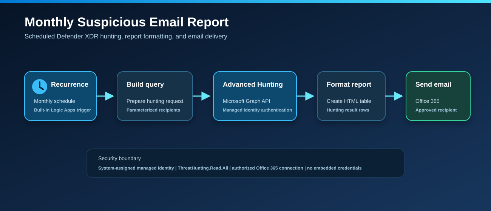

# Monthly Suspicious Email Report

This Consumption Logic App runs a monthly Microsoft Defender XDR Advanced Hunting query through Microsoft Graph, converts the results to HTML, and sends the report through Office 365.

## Prerequisites

1. A commercial Azure subscription and Microsoft Defender XDR tenant.
2. An authorized Office 365 Logic Apps connection.
3. Administrator consent to assign the Microsoft Graph application permission `ThreatHunting.Read.All` to the Logic App managed identity.

## Connectors

| Component | Purpose |
| --- | --- |
| Microsoft Graph HTTP | Runs `security/runHuntingQuery` with managed identity |
| Office 365 | Sends the HTML report |

## Deployment

## Architecture

The diagram uses generic services and data flow only. It contains no tenant, subscription, device, user, recipient, or message identifiers.

## After Deployment

1. Assign `ThreatHunting.Read.All` to the system assigned managed identity.
2. Authorize the Office 365 API connection if its status is not connected.
3. Run the recurrence trigger manually and review action statuses.

## Retention Constraint

Microsoft Graph Advanced Hunting queries only the past 30 days. An exact 31 day calendar month requires retained data in Azure Monitor Logs.
